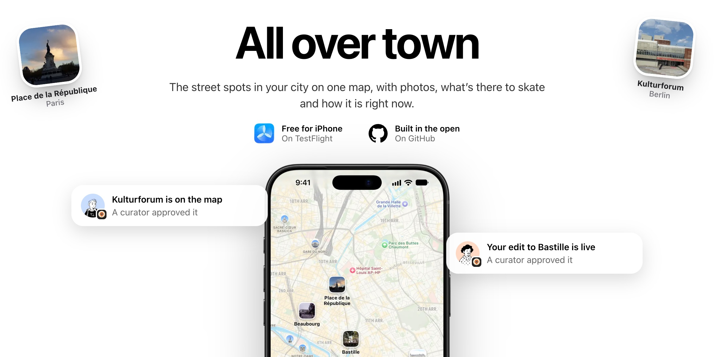

  

<h1 align="center">OpenSkateMap for iOS</h1>

  An open, hand-curated map of skate spots, for iPhone.

  <a href="RUNNING.md">Running it locally</a> ·
  <a href="CONTRIBUTING.md">Contributing</a> ·
  <a href="https://github.com/OpenSkateMap/cloud">Backend</a> ·
  <a href="https://openskatemap.app">openskatemap.app</a>

## About

Skaters add the spots they know, with photos, obstacles and how rough the ground is. Before a spot shows on the
map, someone who skates that city checks it. The result is a map you can trust, built in the open.

- **Discover:** a map of photo pins and clusters, search for spots and places, and a sheet for each spot.
- **Contribute:** add a spot or suggest an edit, even offline; it sends when you're back.
- **Review:** each city's curators approve, adjust or turn down what comes in, with undo.
- **Collections:** private lists, lists shared with friends by @username, or public ones anyone with the link can open.
- **People:** profiles with what someone has added, reports and blocks.
- **Everywhere:** 15 languages, Dynamic Type, VoiceOver, light and dark.

## Localization

OpenSkateMap is localized in these languages:

| Name | Code |
|---|---|
| English | `en` |
| Arabic | `ar` |
| Chinese (Simplified) | `zh-Hans` |
| Chinese (Traditional) | `zh-Hant` |
| French | `fr` |
| German | `de` |
| Hindi | `hi` |
| Italian | `it` |
| Japanese | `ja` |
| Polish | `pl` |
| Portuguese | `pt` |
| Russian | `ru` |
| Spanish | `es` |
| Turkish | `tr` |
| Ukrainian | `uk` |

Each module keeps its strings in `Resources/<code>.lproj/Localizable.strings`, and `mise run ios:check-translations`
checks that every language has every string. See [.docs/localization.md](.docs/localization.md).

> If a language has mistakes or is missing, open an issue or a pull request.

## Contributing

Bug reports, fixes, tests, docs and translations are welcome. For anything that changes how the app looks or
behaves, open an issue first. [RUNNING.md](RUNNING.md) gets the app running against a local backend, and
[CONTRIBUTING.md](CONTRIBUTING.md) covers how it's built and how changes land. To report a security issue, see
[SECURITY.md](SECURITY.md).

## License

The code is free software under the GNU General Public License, version 3 or later: see [LICENSE](LICENSE), with
one additional permission: it may be distributed through the App Store and TestFlight
([APP-STORE-EXCEPTION.md](APP-STORE-EXCEPTION.md)).

## Assets

The code licence doesn't cover the OpenSkateMap name, the app icons, the brand logos, the screenshots or the test
images. [NOTICE.md](NOTICE.md) lists each with its terms. If you ship a modified version, give it a name and icon of
its own.

The sign-in footage isn't in this repository, so your builds show a plain dark sign-in screen.
